<!-- Generated by scripts/build-assets.py from profile.json + activity.json. -->

<picture><source media="(max-width: 640px)" srcset="./assets/header-mobile.svg" />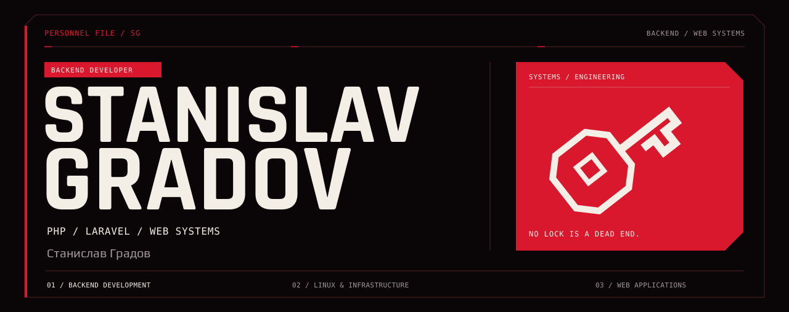</picture><a href="#stack"><picture><source media="(max-width: 640px)" srcset="./assets/nav-stack-mobile.svg" />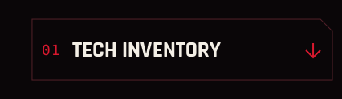</picture></a><a href="#projects"><picture><source media="(max-width: 640px)" srcset="./assets/nav-projects-mobile.svg" />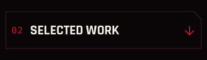</picture></a><a href="#stats"><picture><source media="(max-width: 640px)" srcset="./assets/nav-stats-mobile.svg" />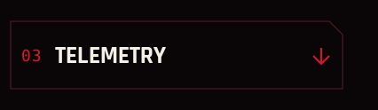</picture></a><picture><source media="(max-width: 640px)" srcset="./assets/stack-mobile.svg" />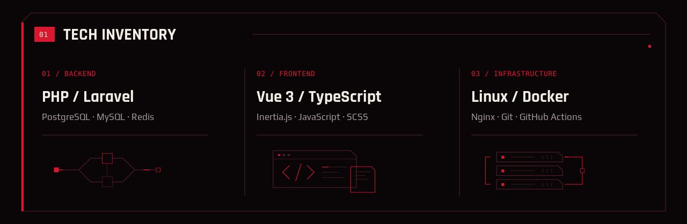</picture><picture><source media="(max-width: 640px)" srcset="./assets/projects-mobile.svg" />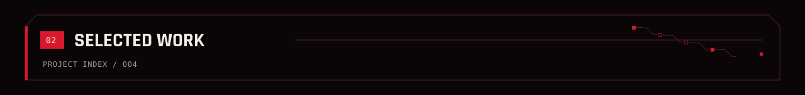</picture><a href="https://github.com/PetkaKahin/eloquent-redis-mirror"><picture><source media="(max-width: 640px)" srcset="./assets/projects/redis-mobile.svg" />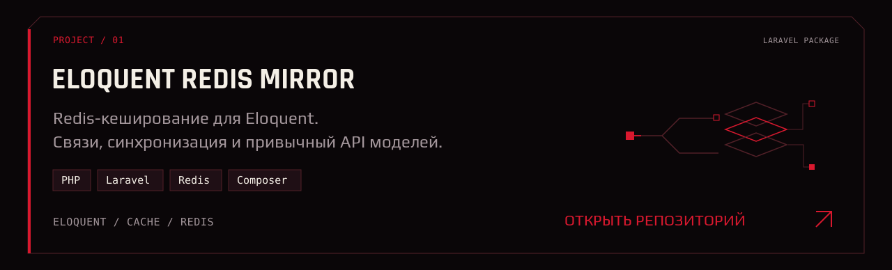</picture></a><a href="https://github.com/PetkaKahin/Task_manager"><picture><source media="(max-width: 640px)" srcset="./assets/projects/tasks-mobile.svg" />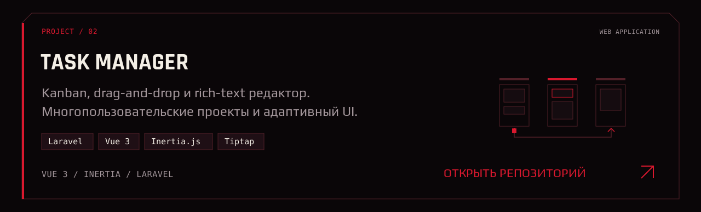</picture></a><a href="https://github.com/PetkaKahin/Laravel_docker"><picture><source media="(max-width: 640px)" srcset="./assets/projects/docker-mobile.svg" />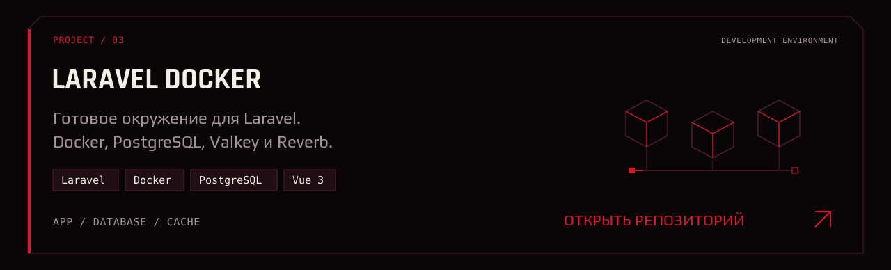</picture></a><a href="https://cyberpunk-red.ru/"><picture><source media="(max-width: 640px)" srcset="./assets/projects/cyberpunk-mobile.svg" />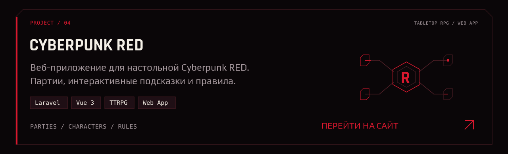</picture></a><a href="https://github.com/PetkaKahin?tab=repositories"><picture><source media="(max-width: 640px)" srcset="./assets/stats-mobile.svg" />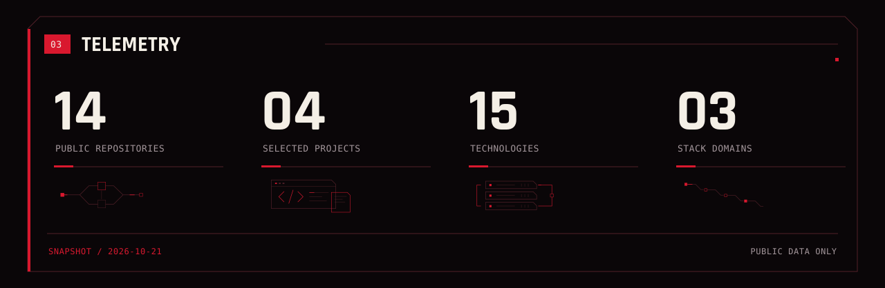</picture></a><a href="https://github.com/PetkaKahin?tab=overview"><picture><source media="(max-width: 640px)" srcset="./assets/activity-mobile.svg" />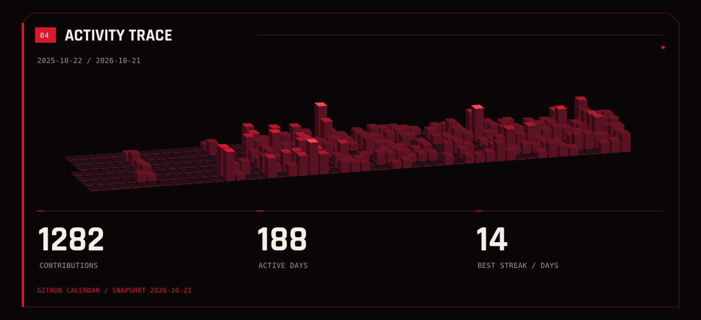</picture><picture><source media="(max-width: 640px)" srcset="./assets/timeline-mobile.svg" />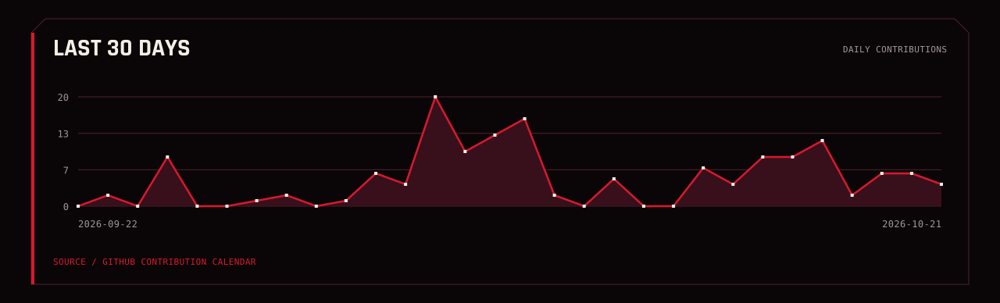</picture></a><picture><source media="(max-width: 640px)" srcset="./assets/footer-mobile.svg" />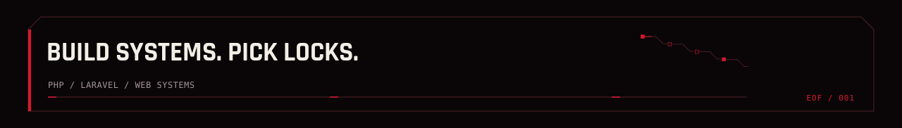</picture>

